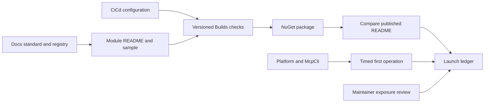

# Hexalith documentation architecture

Docs owns the standard and module registry. Each module owns the README its users see. Builds owns the reusable checker and packaging mechanics. CiCd owns the managed configurations and their delivery. The agent baseline belongs to AI.Tools. Platform owns local composition and McpCli owns the operator interface.

## Invariants and rules

### AD-1 — One standard and one module registry

- **Binds** the guide hub, agent rules, organization profile and migration tooling.
- **Prevents** an unconfirmed module description or package count from becoming a public claim.
- **Rule** Record rule IDs in the standard and module facts in one JSON registry. JSON can be read with the Python standard library. Distinguish unknown, proposed and human-confirmed values. Verify all 21 repositories are represented. A workspace checkout may omit BmadSkills while its inventory and ownership review are pending.

### AD-2 — CI validates the checked-out revision

- **Binds** local runs, hosted checks and management of shared CI config.
- **Prevents** an edit on another repository's default branch from changing yesterday's result.
- **Rule** Enroll modules through CiCd against a released Builds contract. Resolve files and same-repository badge workflow paths against the checked revision. Use the same rules and findings locally. Enroll in warning mode first. Promote each pilot to fail mode after the maintainer reviews the outstanding findings. Put external network checks in a separate scheduled run.

### AD-3 — Test the material a reader receives

- **Binds** the package example, packing, release selection and verification.
- **Prevents** green library tests from concealing an unusable README or an old package page.
- **Rule** A fresh consumer must run the displayed code against packages built from that revision. For every pilot package, verify the nuspec README entry against its intended source, including project-specific documentation. Module documentation migrations use the narrowly scoped README release rule. Record the released version, package count and verified public README before claiming a successful republish.

### AD-4 — Platform owns the timed local journey

- **Binds** the cold-host kit, Platform setup and the user-facing Try it link.
- **Prevents** a warm developer checkout or partial topology from certifying the 20-minute target.
- **Rule** Obtain SDK and Aspire pins from Platform's own configuration. Use one Dapr home for install and run. Measure from the prescribed entry page through readiness and an observed create/list operation with the same tenant. Record the actual prerequisites, tester role, duration, tool version and friction, keeping tokens out of the log.

### AD-5 — Publication requires human evidence

- **Binds** the launch ledger, repository visibility and exposure review.
- **Prevents** private findings, credentials or unsupported readiness claims appearing in public guides.
- **Rule** The maintainer keeps item-level findings and remediation in a private review record. The ledger records reviewed revisions, counts, role and status. Changing visibility, enabling safeguards, starting a package release, accepting an outside test and deciding launch require the corresponding owner.

## Flow of changes and evidence

## Delivery boundaries

| Result | Required evidence | Responsible owner |
| --- | --- | --- |
| Guide ready for public access | Confirmed registry values, exposure disposition, links work signed out | Docs and security maintainers |
| Pilot ready for adoption | Displayed sample runs, badge resolves, package contents match, warning baseline reviewed | Module owners |
| Hosted checks enabled | Versioned shared contract delivered and hosted run recorded | Builds and CiCd |
| Package page current | Latest stable version and rendered README verified per package ID | Release maintainer |
| First operation ready | Two of three agent runs within 20 minutes, followed by outside-tester evidence | Platform and launch maintainer |

## Deferred decisions

The December decision points use the ledger and measured review capacity. A measured cold-start bottleneck triggers the PRD's prebuilt-image decision. Chat qualification waits for ChatBot in Platform. Registry descriptions, supported agent versions and repository visibility still need maintainer confirmation.
