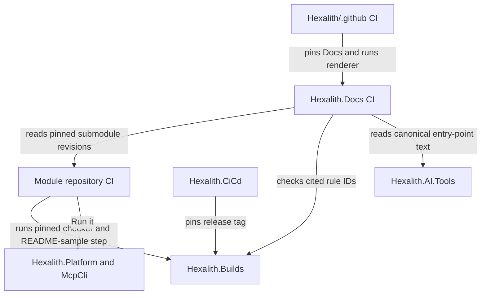
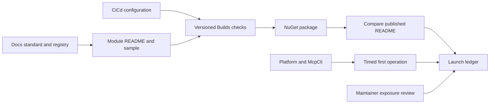
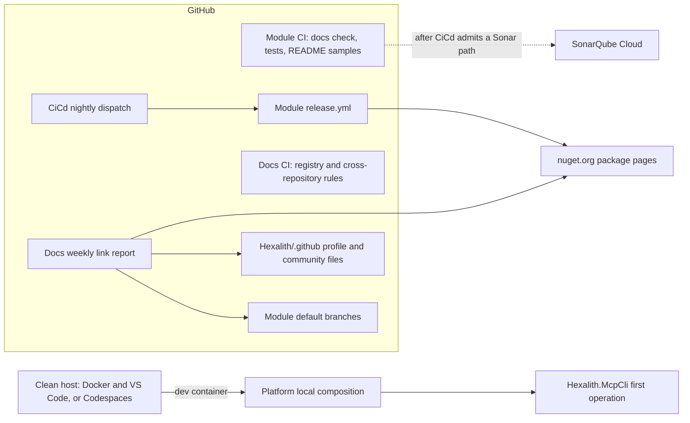

# Hexalith documentation architecture

## Design paradigm

**Distributed ownership with a shared validation pipeline.** Docs owns the standard and module registry. Each module owns the README its users see. Builds owns the reusable checker and packaging mechanics. CiCd owns the managed configurations and their delivery. The agent baseline belongs to AI.Tools. Platform owns local composition and McpCli owns the operator interface.

| Owner | Owns | Lives in |
| --- | --- | --- |
| Hexalith.Docs | Standard and rule catalog, registry, templates, renderer, cross-repository checks, link report, stranger-test kit, launch ledger | `docs/`, `templates/`, `scripts/`, `tools/`, `_bmad-output/implementation-artifacts/` |
| Each module | README, package READMEs, development and operations pages, dev container, LICENSE | Its repository, outside the CiCd perimeter |
| Hexalith.Builds | Checker, README-sample step, packing, release rules, module tool | `Github/lib/`, `Tools/`, `schemas/` |
| Hexalith.CiCd | `docs`, `readmeSamples` and suppression settings, rendered workflows, commit lint, nightly release | `setup/<Repo>.yml` and the files it renders |
| Hexalith.AI.Tools | Canonical entry-point text and documentation rules | Shared instruction files |
| Hexalith.Platform, Hexalith.McpCli | Module run, local composition, first operation | Platform tool, `Hexalith.McpCli` |
| Hexalith/.github | Organization profile, community files | `profile/README.md`, community files |

## Inherited invariants

| Inherited | From | Binds here |
| --- | --- | --- |
| CiCd AD-1 | Hexalith.CiCd spine | A commit's CI result depends only on that commit. `hexalith-ci.json` is complete, so every documentation knob is rendered explicitly (amendment pending). |
| CiCd AD-2 | Hexalith.CiCd spine | Builds code names no module. All variation comes from `hexalith-ci.json` and the perimeter. |
| CiCd AD-3 | Hexalith.CiCd spine | Documentation settings are set in CiCd `setup/<Repo>.yml`. Unknown keys fail. |
| CiCd AD-4, AD-7 | Hexalith.CiCd spine | Module agents never edit `.github/workflows/`, `hexalith-ci.json`, `dependabot.yml`, the Builds gitlink or the `hexalith-cicd` marker block. Their tokens can't push workflows. |
| CiCd AD-10, AD-16, AD-17 | Hexalith.CiCd spine | Releases come from commit analysis. Amendment pending: the module `docs(readme)` patch rule (AD-11). |
| CiCd AD-11 | Hexalith.CiCd spine | The checker and Docs tooling are Python 3.12 or later, standard library only. `run:` steps invoke scripts. Downloaded binaries are SHA-256 checked. |
| CiCd AD-12 | Hexalith.CiCd spine | The docs check runs in the prepare step after the stage-1 guard. The README-sample step joins stage 3 (amendment pending). |
| CiCd AD-14 | Hexalith.CiCd spine | No hook action calls Builds. The CI job holds only the pull-only registry pair. |
| CiCd AD-15 | Hexalith.CiCd spine | `check.py` runs the same docs check locally. There is no pre-push hook. |
| CiCd AD-18 | Hexalith.CiCd spine | The nightly run dispatches every adopted module's release, so a releasable commit on `main` reaches nuget.org that night. |
| CiCd AD-20 | Hexalith.CiCd spine | Documentation adds no Builds workflow. Standalone callers reuse the checker script. |
| CiCd AD-21 | Hexalith.CiCd spine | `SONAR_TOKEN` is a legacy secret that adoption removes. |
| Platform AD-1 | Hexalith.Platform spine | Only Platform's Aspire model composes multi-module environments. No quickstart starts a module-owned AppHost. |
| Platform AD-4 | Hexalith.Platform spine | The module workspace initializes only direct `references/*` submodules. EventStore, Memories and McpCli run from the Platform workspace. |
| Platform AD-11 | Hexalith.Platform spine | Hexalith.McpCli is the only module-operation surface. Legacy CLI and MCP hosts are frozen (AD-18). |

## Invariants and rules

### AD-1 — One standard and one module registry [ADOPTED]

- **Binds** the guide hub, agent rules, organization profile and migration tooling.
- **Prevents** an unconfirmed module description or package count from becoming a public claim.
- **Rule** Record rule IDs in the standard and module facts in one JSON registry. JSON can be read with the Python standard library. Distinguish unknown, proposed and human-confirmed values. Verify all 21 repositories are represented. A workspace checkout may omit BmadSkills while its inventory and ownership review are pending.

### AD-2 — CI validates the checked-out revision [ADOPTED]

- **Binds** local runs, hosted checks and management of shared CI config.
- **Prevents** an edit on another repository's default branch from changing yesterday's result.
- **Rule** Enroll modules through CiCd against a released Builds contract. Resolve files and same-repository badge workflow paths against the checked revision. Use the same rules and findings locally. Enroll in warning mode first. Promote each pilot to fail mode after the maintainer reviews the outstanding findings. Put external network checks in a separate scheduled run.

### AD-3 — Test the material a reader receives [ADOPTED]

- **Binds** the package example, packing, release selection and verification.
- **Prevents** green library tests from concealing an unusable README or an old package page.
- **Rule** A fresh consumer must run the displayed code against packages built from that revision. For every pilot package, verify the nuspec README entry against its intended source, including project-specific documentation. Module documentation migrations use the narrowly scoped README release rule. Record the released version, package count and verified public README before claiming a successful republish.

### AD-4 — Platform owns the timed local journey [ADOPTED]

- **Binds** the cold-host kit, Platform setup and the user-facing Try it link.
- **Prevents** a warm developer checkout or partial topology from certifying the 20-minute target.
- **Rule** Obtain SDK and Aspire pins from Platform's own configuration. Use one Dapr home for install and run. Measure from the prescribed entry page through readiness and an observed create/list operation with the same tenant. Record the actual prerequisites, tester role, duration, tool version and friction, keeping tokens out of the log.

### AD-5 — Publication requires human evidence [ADOPTED]

- **Binds** the launch ledger, repository visibility and exposure review.
- **Prevents** private findings, credentials or unsupported readiness claims appearing in public guides.
- **Rule** The maintainer keeps item-level findings and remediation in a private review record. The ledger records reviewed revisions, counts, role and status. Changing visibility, enabling safeguards, starting a package release, accepting an outside test and deciding launch require the corresponding owner.

### AD-6 — Each check judges only what its own commit pins

- **Binds** the Builds checker, Docs CI, standalone callers and the registry rules (FR-11, FR-38, FR-39, FR-41, FR-43, FR-64, NFR-7).
- **Prevents** a module's result changing because Docs or another repository changed, two implementations of one rule, and a red Docs build for every module not yet migrated.
- **Rule**
  - Builds' `docs_check.py` is the only per-repository checker. It runs in the CI prepare step after the stage-1 guard and before restore, in the mode the `docs` knob sets, and `check.py` calls the same function [ADOPTED]. It adds at most 2 minutes to an EventStore CI run.
  - Its checked pages come from the checkout alone: the root README, every `README.md` beside a `.csproj` under `src/`, and the docs pages the root README links to directly. It never reads the registry.
  - A standalone caller (Docs, BmadSkills, CiCd, `Hexalith/.github`) runs the same script from a Builds checkout pinned to a release tag, with a committed page profile of `module`, `hub` or `org` that selects the applicable rules [ASSUMPTION].
  - Docs CI owns every rule that needs the registry: verbatim description, quickstart order, package IDs, the package-README set, badge sources and Sonar key. It judges them against the root-declared submodule revisions its own commit pins, initialized without recursion. A registry finding fails Docs CI only for a row whose pinned checkout renders `docs: fail`. Other rows report. The same Docs script runs locally for one module.
  - A repository's Level 1 evidence is a Docs commit whose gitlink equals the accepted revision and whose registry check passed.

### AD-7 — Links are checked offline per commit and online on schedule [ADOPTED]

- **Binds** D-LINK, the checker, migrations and the scheduled report (FR-45).
- **Prevents** a rate limit or flaky host turning a module red, and a broken self-link passing.
- **Rule**
  - Per commit, the checker resolves relative paths, in-page fragments and self-links against the checkout, without network access. Self-links are `https://github.com/Hexalith/<self>/{blob,tree,raw}/main/…` and `https://raw.githubusercontent.com/Hexalith/<self>/{main,refs/heads/main}/…`. A self-link to any other ref is a finding.
  - One Docs link script checks links to other Hexalith repositories, external destinations and badge images. It uses lychee, deduplicates by URL, and also runs in single-repository mode as each migration's online check [ASSUMPTION].
  - The scheduled run goes every Monday at 06:00 UTC with Docs' own `GITHUB_TOKEN` and `issues: write`. It updates one pinned report issue in Docs and the job summary, and fails only on its own errors. It also reads live default branches and reports drift from the pinned revisions.

### AD-8 — One rule catalog and one finding contract

- **Binds** the standard's rule table, checker output, AI.Tools rules, suppressions and fail-mode promotion (FR-42, FR-44, FR-46, FR-47, FR-49).
- **Prevents** a finding citing an undefined rule, an agent suppressing the rule that polices it, and a new rule turning fail-mode repositories red on delivery.
- **Rule**
  - Rule IDs take the form `D-<NAME>` and exist only in the table in `docs/documentation-standard.md`. An ID enters the table before any Builds release emits it. Planning content gets its own ID, `D-PLANNING`, split from D-LOCATION [ASSUMPTION]. Builds findings and AI.Tools rules cite only catalog IDs. A Docs test checks the pinned Builds and AI.Tools submodules against the table.
  - A finding is one JSON line `{file, line, rule, level, hint}` with `level` set to `report` or `fail` [ASSUMPTION]. Docs CI findings add `repository`.
  - A finding fails a run only when the repository's mode is `fail`, its level is `fail`, it sits on a checked page and no suppression matches.
  - Managed modules get suppressions only from CiCd setup, rendered into `hexalith-ci.json`. Standalone callers commit theirs in `.github/hexalith-docs.json` [ASSUMPTION]. An entry is `{file, rule, match, reason}`, where `match` is the exact suppressed text. Only a `D-PLANNING` match on a 40-character SHA of a pinned action or submodule commit can be suppressed. D-BADGE can't. The job summary prints the suppression count, and the weekly report totals them across repositories.
  - A new or widened rule ships at `report` level. Builds raises it to `fail` in a later release, and only after the weekly report shows zero findings for it in every fail-mode repository.
  - A repository moves to `docs: fail` through a CiCd setup change that the maintainer approves after reviewing its findings. Its ledger row records the revision and the hosted run.

### AD-9 — README samples run as one Builds step

- **Binds** "Use the package" blocks, package READMEs, CI stage 3 and package verification (FR-16, FR-19, D-QUICKSTART). Extends AD-3.
- **Prevents** 14 publishers writing 14 extraction scripts, a hook action calling Builds, a consumer restoring an old package from nuget.org, and a displayed sample that no test runs.
- **Rule**
  - Builds' reusable `ci.yml` runs one native README-sample step in stage 3, after unit tests and before the `after-unit-tests` hook. The step runs when the `readmeSamples` knob CiCd renders is `true` [ASSUMPTION].
  - The step packs the stage-2 Release outputs into a temporary feed at a version no public feed carries. Each consumer's `NuGet.Config` clears every other source. Consumers target the framework of the repository's SDK major.
  - A sample is one or more consecutive `csharp` blocks, followed directly by exactly one `text` block holding the expected output. Samples sit in the root README's "Use the package" block or under a package README's `## Usage` heading [ASSUMPTION]. Earlier blocks become type files, and the last block holds the top-level statements. Each sample prints its documented result, and output must match line by line. A prompt block never directly follows a `csharp` block.
  - The pilots' hook scripts stay until the Builds release ships. Then each hook drops its sample step. A publisher reaches Level 1 only after a hosted run in which the step ran.

### AD-10 — "Run it" runs through Platform and ends with a McpCli call

- **Binds** every module's "Run it" block, its prompt and the registry's quickstart field (FR-20, FR-58, Open Question 14).
- **Prevents** a README starting a frozen module AppHost, a second composition path, an unpinned module tool, or a first call through a legacy surface.
- **Rule**
  - A block is eligible only when the repository has `module/hexalith.module-manifest.v2.json`, a direct `references/Hexalith.Platform` gitlink and `Hexalith.Builds.Module.Cli` pinned in `.config/dotnet-tools.json` at the version that Platform revision pins.
  - The block opens the repository dev container, runs `dotnet tool restore`, then `dotnet tool run hexalith-module -- run --manifest module/hexalith.module-manifest.v2.json` from the module workspace. EventStore, Memories and McpCli start from a Platform checkout, with the manifest path under `references/`.
  - The block ends with one call through the McpCli build that the Platform tool produces for that run, and shows its expected output.
  - Only the Platform README starts Platform's own AppHost. No module quickstart or prompt uses `aspire run`.
  - The registry lists planned blocks, and the ledger records each block's qualification. A README shows only qualified blocks, so an ineligible or unqualified "Run it" stays reserved.

### AD-11 — Documentation commits and the release start

- **Binds** migration commits, republishing, commit lint and verification of the nightly release (FR-13, FR-14, FR-15). Extends AD-3 and AD-5.
- **Prevents** agents relabeling documentation as `fix:`, an unreviewed README reaching nuget.org through the nightly release, and planning IDs reaching release notes.
- **Rule**
  - Migration work lands as `docs:` commits, which never release.
  - After Level 1 review, the module owner makes or explicitly approves the single `docs(readme): …` commit. Because the nightly run dispatches releases, that commit starts the release (AD-5). Make it only after the delivered Builds tag contains the `docs(readme)` rule. The release record lists any non-docs commits the patch carries, and the owner accepts them.
  - Builds' own README ships with its next release, since Builds releases on any non-docs commit. The Hexalith.McpCli README ships with the next Platform publication (Platform AD-11).
  - No commit subject or scope carries a story, epic, FR or other planning ID. CiCd's commit lint gains this rule by amendment (Open Question 11). Until then, migration review enforces it.
  - Republish verification takes the expected IDs from the release's `hexalith-release-packages` trailer. It compares nuget.org with the README blobs at the `v<version>` tag commit [ASSUMPTION].

### AD-12 — Quickstart runs never stop on the contributor baseline

- **Binds** the canonical entry-point text, the three entry points in every repository, quickstart prompts and the dev container post-create step (FR-22, FR-48, FR-63, NFR-9, D-PROMPT).
- **Prevents** a newcomer's agent halting in a fresh clone that lacks `references/Hexalith.AI.Tools`, entry points with three different writers, and prompts that frame the task differently.
- **Rule**
  - AI.Tools owns the canonical normalized text of `AGENTS.md`, `CLAUDE.md` and `.github/copilot-instructions.md`. Each repository carries that text byte for byte, plus only the `hexalith-cicd` marker block. Docs CI compares each pinned repository's entry points with the canonical text at Docs' pinned AI.Tools revision.
  - That text limits "stop and report a missing baseline" to repository work, and states that running a README quickstart isn't repository work.
  - Every quickstart prompt opens with the line `You are running a Hexalith quickstart.`
  - The dev container `postCreateCommand` initializes only root-declared submodules, without recursion.
  - Only a maintainer changes entry points or dev container files. A migration installs the canonical text and the template verbatim. Guard protection stays with CiCd (Open Question 19).
  - Secrets go into a git-ignored `.env.local` at the repository root or a hidden prompt, never into a prompt or a commit [ASSUMPTION].

### AD-13 — Every environment pin has one upstream

- **Binds** dev container templates, prerequisite lists and the stranger-test kit (FR-5, FR-18, D-PREREQUISITES). Extends AD-4 to every dev container.
- **Prevents** a dev container and its repository disagreeing on SDK, Aspire or Dapr versions, and a README listing versions no file enforces.
- **Rule**
  - The base image is `mcr.microsoft.com/devcontainers/dotnet` at an exact tag whose .NET major equals the SDK major in `global.json`. The checker compares the two from the checkout.
  - Dev container files never state Aspire or Dapr versions. `postCreateCommand` runs `dotnet tool restore` and Platform's setup with the pinned module tool. Setup installs the Dapr CLI and runtime that the tool's catalog requires into the single home named by `HEXALITH_DAPR_HOME`, which install and run share. It installs the Aspire CLI that matches the Aspire version pinned by the AppHost that runs the block [ASSUMPTION].
  - Setup also installs any extra runtime the Platform README lists.
  - Prerequisite lists restate the installed versions. Each clean-environment run compares them with what setup installed, and records both.

### AD-14 — Pages derived from the registry are generated

- **Binds** the organization profile catalog, About descriptions and the organization CONTRIBUTING development-guide list (FR-25, FR-28, FR-33, FR-36).
- **Prevents** the profile, About text and registry drifting apart through hand edits, and two owners of the profile.
- **Rule**
  - `Hexalith/.github` pins Docs as a submodule and runs the Docs renderer in its own CI [ASSUMPTION].
  - The renderer writes only between `hexalith-docs` begin and end markers in `profile/README.md` and `CONTRIBUTING.md`, using only confirmed descriptions and categories. The `.github` CI fails when committed text differs from rendered text.
  - A maintainer sets each GitHub About description from the registry. The weekly report flags differences.

### AD-15 — Migrations work in the owning repository and name their inputs

- **Binds** every migration story and the migration prompt (FR-7, FR-57).
- **Prevents** an agent editing one checkout while checking another, nested submodule initialization, and migrations following different template revisions.
- **Rule**
  - A migration edits and commits in the owning repository's checkout. It validates messages with that repository's pinned commit lint.
  - From the Docs workspace, the local check runs `python3 references/Hexalith.Builds/Github/lib/docs_check.py --root references/<Repo> --repository Hexalith/<Repo> --mode fail` and initializes no nested submodule. The hosted run at the module's `buildsTag` is the evidence.
  - Each migration records, in its ledger row, the Docs commit whose templates and registry it followed and the AI.Tools revision its entry points came from.

### AD-16 — Shared state has one write path

- **Binds** the registry, the launch ledger and trial records (FR-2, FR-56). Extends AD-1 and AD-5.
- **Prevents** parallel agents overwriting each other's rows, agents confirming their own descriptions, and a registry row disagreeing with its pinned checkout.
- **Rule**
  - A registry row changes only in the Docs commit that advances that module's gitlink, or in a maintainer commit. Only a maintainer commit sets a status to `confirmed`. Agents write `proposed` values or `null`.
  - The ledger has one row per registry repository. Only that repository's migration or the maintainer edits it.
  - Each trial writes its own record under `_bmad-output/implementation-artifacts/trials/`, and the row links to it [ASSUMPTION].

### AD-17 — SonarQube Cloud appears only where CiCd delivers it

- **Binds** Sonar analysis, Sonar badges and the registry `sonarKey` (FR-38, FR-39, FR-40).
- **Prevents** a module adding its own Sonar token or workflow, divergent project keys, and a badge that reads no live analysis.
- **Rule**
  - Sonar analysis runs only through a path CiCd admits. FR-40 needs that CiCd amendment first.
  - The registry `sonarKey` is the only key source, in the existing `Hexalith_<RepositoryName>` form [ASSUMPTION].
  - A README shows Sonar badges only once its registry `sonarKey` is set. The Docs maintainer sets it after CiCd delivers analysis.
  - A managed module's CI badge names only the CiCd-rendered `ci.yml`.

### AD-18 — Legacy surface packages carry a notice, not a quickstart

- **Binds** the package READMEs of frozen CLI and MCP surfaces, the registry and republishing (FR-15, FR-16).
- **Prevents** a republished README presenting a frozen surface as current, and those IDs dropping out of the package count.
- **Rule** The registry flags each package ID of a legacy surface that Platform AD-11 freezes [ASSUMPTION]. That package's README is a short notice that it is obsolete, naming Hexalith.McpCli. Its ID stays in the republish count. No quickstart, sample or profile entry names it.

### Dependency direction

Arrows point from a repository to what it depends on at build or run time. No module CI reads Docs or the registry. CiCd writes only its perimeter files into each module (CiCd AD-4). That write isn't a dependency, so it isn't drawn.



## Flow of changes and evidence



## Consistency conventions

| Concern | Convention |
| --- | --- |
| Rule IDs | `D-<NAME>` from the standard's table. Never numbered, renamed or reused. |
| Findings | One JSON line `{file, line, rule, level, hint}`. `file` is a repository-relative POSIX path, `line` starts at 1, `hint` is one imperative sentence. |
| Registry | `docs/module-registry.json`: integer `schemaVersion`, camelCase keys, one row per repository. Status values are `confirmed` or `proposed`, plus `unconfirmed` for an absent category. Unknown facts are `null`, never guessed. |
| Quickstart names | "Use the package", "Run it" and "Use the tool", in registry order. "Start here" when a repository has none. |
| Sample shape | Consecutive `csharp` blocks followed by one `text` block of expected output (AD-9). |
| Prompts | Ten lines or fewer. They open with `You are running a Hexalith quickstart.` and use the same setup command and first-success check as the manual steps. |
| Secrets | A git-ignored `.env.local` at the repository root, or a hidden prompt. Never pasted, logged or committed. |
| Commits | Conventional Commits, validated by the owning repository's pinned commit lint. `docs:` for migration work, `docs(readme)` only for the owner's release commit. No planning IDs. |
| Links | READMEs use absolute HTTPS links and images, because NuGet renders no relative links. In-page `#fragment` links are allowed. Docs pages may link relatively inside their repository. |
| Vocabulary | "Business module" and "technical module" (D-IDENTITY). |
| Evidence | Ledger rows keyed by registry repository name. Testers identified by role. Local results labeled apart from published evidence. Dates in `YYYY-MM-DD`. No tokens. |
| Tooling | Python 3.12 or later, standard library only. `unittest` tests under `scripts/tests/`. No network access in per-commit checks. |

## Stack

| Name | Version |
| --- | --- |
| Python for the checker and Docs tooling | 3.12 or later, standard library only |
| .NET SDK | 11.0.100 in every module `global.json`, with `rollForward` set per repository |
| Aspire | 17.0.0 at Platform `b0159ad4`; older Platform pins in module workspaces use 13.6.5 |
| Hexalith.Builds.Module.Cli (`hexalith-module`) | 6.3.0 pinned by Platform `b0159ad4` |
| Hexalith.McpCli | 3.0.0, built per run by the Platform tool |
| Dapr CLI and runtime | As required by the pinned module tool's catalog: 1.19.1 for tool 6.3.0; runtime 1.19.2 is current |
| Builds release with the checker and `docs(readme)` rule | First tag after v6.4.4 that contains `aaf27a2c` |
| Dev container base image | `mcr.microsoft.com/devcontainers/dotnet:3.0.1-11.0-resolute` |
| Dev container features | docker-in-docker 4.1.3, python 1.8.1 |
| lychee, for the Docs link script only | v0.24.2 |
| GitHub-hosted runner for Docs workflows | ubuntu-24.04 |
| actions/checkout | v7.0.1 (`3d3c42e5aac5ba805825da76410c181273ba90b1`) |
| Contributor Covenant | 3.0 |

## Structural seed

```text
Hexalith.Docs/
  README.md                         # Start here
  LICENSE                           # to add after rights are confirmed
  docs/
    documentation-standard.md       # rule catalog and readability checklist
    module-registry.json            # 21 rows, schemaVersion 1
    overview.md                     # cross-module guide
    stranger-test.md                # clean-host trial instructions
  templates/                        # README, development, operations, prompts, migration; dev container to add
  scripts/                          # registry validator, published-README verifier; registry rules, renderer and link script to add
    tests/
  tools/stranger-test.py            # trial kit
  .github/workflows/documentation.yml   # registry validation; cross-repository checks and weekly link report to add
  references/                       # root submodules, read-only pins
  _bmad-output/implementation-artifacts/  # launch ledger, trials/, exposure review, sprint status
```

```text
<Module>/
  README.md                                    # checked page (D-README)
  LICENSE
  src/**/<Package>/README.md                   # checked when beside a .csproj
  docs/development.md, docs/operations.md
  .devcontainer/devcontainer.json              # maintainer-owned, pins per AD-13
  .config/dotnet-tools.json                    # pins hexalith-module for "Run it" (AD-10)
  module/hexalith.module-manifest.v2.json      # enables "Run it" (AD-10)
  AGENTS.md, CLAUDE.md, .github/copilot-instructions.md  # canonical text plus CiCd marker block (AD-12)
  .github/workflows/, .github/hexalith-ci.json  # CiCd-owned, never edited by module agents
  .env.local                                   # git-ignored, never committed
```



## Delivery boundaries

| Result | Required evidence | Responsible owner |
| --- | --- | --- |
| Guide ready for public access | Confirmed registry values, exposure disposition, links work signed out | Docs and security maintainers |
| Pilot ready for adoption | Displayed sample runs, badge resolves, package contents match, warning baseline reviewed | Module owners |
| Hosted checks enabled | Versioned shared contract delivered and hosted run recorded | Builds and CiCd |
| Package page current | Latest stable version and rendered README verified per package ID | Release maintainer |
| First operation ready | Two of three agent runs within 20 minutes, followed by outside-tester evidence | Platform and launch maintainer |

## Capability → architecture map

| Capability (FRs) | Lives in | Governed by |
| --- | --- | --- |
| Standard, registry, templates and guides (FR-1 to FR-8, FR-62) | Docs `docs/`, `templates/` | AD-1, AD-8, AD-13, AD-15, AD-16 |
| README and package pages (FR-9 to FR-16, FR-60) | Each module | AD-3, AD-6, AD-8, AD-9, AD-11, AD-18 |
| Quickstarts and prompts (FR-17 to FR-22) | Module README and dev container | AD-9, AD-10, AD-12, AD-13 |
| "Try it", Kubernetes and chat (FR-23, FR-24, FR-66) | Platform, McpCli, Docs kit | AD-4, AD-10, Platform AD-1, Platform AD-11 |
| Front door and organization (FR-25 to FR-32, FR-65) | `Hexalith/.github`, Docs | AD-5, AD-14 |
| Community files and contributor docs (FR-33 to FR-37, FR-59) | `Hexalith/.github`, each module | AD-14, D-COMMUNITY |
| Quality signals (FR-38 to FR-40) | Module README, Builds CI, SonarQube Cloud | AD-6, AD-7, AD-17 |
| Docs check (FR-41 to FR-46, FR-64) | Builds checker, CiCd settings, Docs CI | AD-2, AD-6, AD-7, AD-8 |
| Agent rules (FR-47 to FR-50, FR-63) | AI.Tools | AD-8, AD-12 |
| Time targets and stranger tests (FR-51 to FR-56, FR-61) | Docs `tools/`, ledger and trial records | AD-4, AD-5, AD-16 |
| Rollout levels (FR-57, FR-58) | Ledger, CiCd setup | AD-2, AD-5, AD-10, AD-15 |

## Upstream amendments and open conflicts

| Owner | Item | Needed by |
| --- | --- | --- |
| Hexalith.CiCd | AD-1 and AD-3: add `docs`, `readmeSamples` and documentation suppressions to the complete knob list, always rendered | Hosted docs check on the pilots |
| Hexalith.CiCd | AD-10, AD-16, AD-17: admit the module `docs(readme)` patch rule | First republish |
| Hexalith.CiCd | AD-12: add the README-sample step to stage 3 | AD-9 Builds release |
| Hexalith.CiCd | Commit-type convention: ban planning IDs in subjects and scopes (Open Question 11) | Before the waves |
| Hexalith.CiCd | AD-7, AD-12, AD-14, AD-21: admit a Sonar analysis path, or descope FR-40 | Sonar badges |
| Hexalith.CiCd | Guard protection for entry points and dev container files (Open Question 19) | First published block |
| Hexalith.Builds | Finding `level`, page profiles, self-link resolver, README-sample step, `D-PLANNING`, a release that contains `aaf27a2c` | Pilot fail mode |
| PRD | FR-5, FR-6, FR-20, UJ-3 and the glossary: module `aspire run` replaced by AD-10. FR-33: Contributor Covenant 3.0. FR-41: no markdownlint-cli2, registry rules in Docs CI. FR-45: per-commit checks cover self-links only. FR-46: managed suppressions live in CiCd setup | Next PRD update |
| Hexalith.Docs | `templates/quickstart-prompts.md` still uses `aspire run` and lacks the fixed first line. `docs/development.md` says Python 3.11 | Story 1.3 acceptance |
| Hexalith.Platform | Is the ASP.NET Core 10 runtime still required at `b0159ad4`, and does setup install the Aspire CLI from the AppHost pin? | Story 1.4 |

## Deferred

- **December decision points.** They use the ledger and measured review capacity.
- **Prebuilt images.** A measured cold-start bottleneck triggers the PRD's prebuilt-image decision (FR-52).
- **Automated "Run it" smoke test in CI.** The agent stranger test remains the verification until the brief's decision 10C is revisited.
- **Chat qualification.** It waits for ChatBot in Platform (FR-66).
- **Maintainer confirmations.** Registry descriptions and categories, supported agent tools and versions, and repository visibility (Open Questions 3 and 15).
- **markdownlint-cli2.** Not adopted, so the per-commit path needs no Node. Revisit if rule coverage needs a Markdown parser.
- **Kubernetes topology and how-to content.** Platform owns them (Platform AD-1). This spine fixes only the untimed qualification (FR-24).
- **Cloud providers and a documentation website.** Outside launch scope.
- **Weekly-job keepalive.** Activity in Docs keeps the scheduled job enabled. Add a keepalive only if GitHub disables it.
- **Legacy SonarQube Cloud projects.** A maintainer decides whether to reuse them (Open Question 18).
